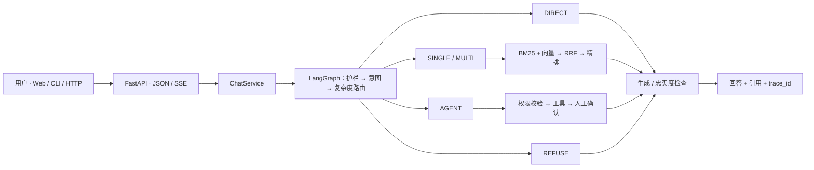

<h1 align="center">Adaptive RAG · 电商客服工作流</h1>

<p align="center"><strong>让简单问题直接回答，让复杂问题找到证据，让业务操作停在确认之前。</strong></p>
<p align="center">FastAPI × LangGraph × 混合检索 · API、流式对话与 ChatGPT 风格 Web 工作台</p>

<p align="center">
  <a href="https://github.com/JEen-wang/Adaptive-rag/actions/workflows/ci.yml"></a>
  <a href="LICENSE"></a>
  
  
  
</p>

<p align="center">
  <a href="#overview">项目亮点</a> · <a href="#quickstart">快速开始</a> ·
  <a href="#architecture">系统架构</a> · <a href="#evaluation">实测结果</a> ·
  <a href="#resume">简历写法</a> ·
  <a href="#docs">完整文档</a> · <a href="#limitations">使用边界</a>
</p>

---

<a id="overview"></a>

## ✨ 一眼看懂

> **Adaptive RAG** 的核心决策是：这个问题需要直接回答、检索一条证据、交叉核对多条证据、调用业务工具，还是拒绝处理？

电商客服里的问题跨度很大。「你好」无需查知识库；退货政策需要可靠出处；「定制商品超过七天但有质量问题」要同时判断定制、时效与质量例外；取消订单则必须检查订单状态、权限与确认。项目用明确的路由策略处理这些差异，避免把所有输入都塞进同一条向量检索链路。

| 能力 | 你能看到什么 | 关键实现 |
|:---|:---|:---|
| 🧭 **按复杂度路由** | 每次回答带有 `strategy`，便于追踪实际路径 | [Graph 与节点](app/agents/graph.py) · [策略枚举](app/core/enums.py) |
| 🔎 **有出处的检索** | BM25、稠密向量、RRF 融合与精排；回答可带 `citations` | [检索模块](app/retrieval/) |
| 🧩 **多跳与自纠错** | 复合问题拆分检索，答案经过忠实度检查 | [智能体节点](app/agents/nodes/) |
| 🛡️ **人工确认** | 高风险写操作先返回 `pending_action`，确认后才执行 | [工具与权限](app/tools/) |
| 💬 **Web 对话工作台** | 流式显示、引用、本地会话搜索、深色模式与确认卡片 | [前端](frontend/) |
| 📈 **可测可观测** | 离线评测、回归测试、结构化日志与 Prometheus 指标 | [评测](eval/) · [可观测性](app/observability/) |

### 五条处理路径

| 策略 | 适合的问题 | 处理方式 |
|:---:|:---|:---|
| `DIRECT` | 问候、闲聊 | 直接生成，不做知识检索 |
| `SINGLE` | 单一政策问题 | 一轮混合检索与精排 |
| `MULTI` | 多条件、跨条款问题 | 查询改写、多路检索与自纠错 |
| `AGENT` | 查询订单、物流或发起业务操作 | 规划后调用受权限约束的工具 |
| `REFUSE` | 越权、注入或证据不足 | 拒答或引导人工处理 |

> [!TIP]
> 第一次了解项目，可以先看[架构图](#architecture)，再按[快速开始](#quickstart)提问。想看每条路径怎样落到代码，读[智能体与工具](docs/05-agents-and-tools.md)。

<a id="quickstart"></a>

## 🚀 快速开始

默认使用 SQLite 和内存检索组件，不要求先部署 Redis 或 Qdrant。需要 **Python 3.11+**；Web 开发另需满足[前端 Node.js 要求](frontend/README.md)。

### 1. 安装并启动 API

```bash
git clone https://github.com/JEen-wang/Adaptive-rag.git
cd Adaptive-rag
python3 -m venv .venv
source .venv/bin/activate
pip install -e ".[dev]"
cp .env.example .env
uvicorn app.asgi:app --reload --port 8000
```

Windows PowerShell 激活虚拟环境可使用 `.venv\Scripts\Activate.ps1`。首次启用本地 Embedding / Cross-Encoder 时可能需要下载模型；需要完整的本地精排依赖可安装 `pip install -e ".[rerank]"`。更多选项见[配置参考](docs/07-configuration.md)。

`.env` 中的 `DEEPSEEK_API_KEY` 可留空：此时系统进入离线演示模式，展示检索原文或可核对的订单状态，不会假装生成完整答案。要体验生成式回答，需要配置可用的 DeepSeek 密钥。**不要提交 `.env` 或密钥。**

### 2. 发送第一条消息

```bash
curl -s http://127.0.0.1:8000/api/v1/health
curl -s http://127.0.0.1:8000/api/v1/chat \
  -H 'content-type: application/json' \
  -d '{"message":"定制马克杯过了七天，但有质量问题还能退吗？","user_id":"u_demo"}'
```

响应包含 `answer`、`strategy`、`trace_id`，需要检索时还会带 `citations`。也可以运行 `python -m app.cli` 进入终端对话；流式接口为 `POST /api/v1/chat/stream`，完整字段见 [API 参考](docs/06-api-reference.md)。

### 3. 打开 Web 工作台

保持 API 运行，另开终端：

```bash
cd frontend
npm ci
npm run dev
```

访问 **http://127.0.0.1:5173**。开发服务器会把 `/api` 代理到本地 FastAPI。执行 `npm run build` 后，FastAPI 检测到 `frontend/dist` 也会在根路径提供页面；Docker 镜像会自动构建前端。前端会话列表存于浏览器本地，详见[前端 README](frontend/README.md)。

<details>
<summary><strong>🧪 想体验订单工具与人工确认？展开查看演示数据步骤</strong></summary>

<br>

当前分支默认启动**不会自动写入**演示订单。先停止 API，在仓库根目录、已激活虚拟环境的终端执行：

```bash
python - <<'PY'
import asyncio
from app.config.settings import get_settings
from app.services.container import build_container

async def main():
    container = await build_container(get_settings(), seed=True)
    await container.aclose()

asyncio.run(main())
PY
```

然后重新启动 API。种子会为 `u_demo` 写入 `ORD10001`（已发货）、`ORD10002`（已签收）和 `ORD10003`（已支付未发货）。例如询问“取消订单 ORD10003”，系统先给出 `pending_action.action_id`；确认请求携带该 ID 后才执行。详见 [HITL 与幂等](docs/05-agents-and-tools.md)。

</details>

<a id="architecture"></a>

## 🏗️ 系统架构



HTTP 层处理校验与序列化，`ChatService` 编排对话，Graph 决定路径，检索器与工具由容器装配。默认数据库为 SQLite；Redis、Qdrant 和远程模型按配置接入。完整的节点、降级路径和依赖关系见[架构与运行流程](docs/17-architecture-flow.md)。

<a id="evaluation"></a>

## 📊 实测结果与口径

下面的**检索与生成指标**来自 2026-08-22 的离线评测，具体数据集、模型与运行命令见 [`eval/MEASURED.md`](eval/MEASURED.md) 和[完整报告](docs/14-evaluation-report.md)。报告原始 JSON 未随仓库分发，复现时应以当前环境重新运行。

| 环节 | 样本与设置 | 结果 |
|:---|:---|:---|
| 意图识别 | 100 条，`intent_v3` + 歧义规则覆盖 | **100%**；纯模型结果并非 100% |
| BM25 稀疏检索 | 65 条政策问题 / 39 篇文档 | P@1 **76.9%** · R@3 **90.0%** |
| bge-small 稠密检索 | 同一检索集 | P@1 **83.1%** · R@3 **94.6%** |
| Hybrid + Cross-Encoder | 同一检索集 | P@1 **89.2%** · R@3 **97.7%** · MRR **0.94** |
| RAG + 自纠错生成 | 65 条，同模型裁判 | 忠实度 **100%** · 幻觉率 **0%** |
| 端到端 | 16 条 | 关键词命中 **9/11** · P50 **4.9s** · P95 **5.8s** |

> [!IMPORTANT]
> 这些是**指定离线集合与模型配置**下的测量值，不代表生产环境承诺。该集合上 RRF 与单独使用 bge-small 的检索数字相同，主要增益来自 Cross-Encoder；生成忠实度使用同模型裁判，可能偏乐观。不要把 `0%` 幻觉率理解为真实场景零错误。

CI 在 Python 3.11 / 3.12 上检查锁文件、Ruff、mypy 和 pytest；[查看工作流](.github/workflows/ci.yml)。本地可运行：

```bash
python -m pytest -q
python -m eval.runner --task retrieval
cd frontend && npm test && npm run build
```

<a id="resume"></a>

## 📝 简历写法

**基于 Adaptive-RAG 的电商客服**

**项目概述：** 针对基于 FAQ 的传统客服系统长尾问题命中率极低，人工介入成本高的问题和常规 RAG 多跳推理能力差，幻觉问题严重的痛点设计并实现了基于 Adaptive-RAG 的多智能体电商客服系统。

- **架构设计：** 基于 LangGraph 搭建核心状态机，规划器与执行器，统一接入 15 个核心工具，实现流式输出与指数退避+抖动重试；解析意图识别，采用 Prompt-template+DeepSeek v3 构建意图路由节点并通过 LLM 自主决策分解子任务并调用工具，自建 100 条测试 query 测试意图识别准确率达到 97%。

- **检索阶段：** FAQ、退货策略、配送说明等文档进行预处理、切分、向量化索引。基于 Adaptive-RAG 实现科学感知的逻辑路由，动态调度检索策略，并通过问题改写和混合检索，解决多跳问题。

- **检索优化：** 基于 Self-RAG 构建多轮检索策略，并利用 RRF 算法对多源异构检索结果进行融合与去重，随后调用 Cohere 模型进行重排序。

  **Precision 58%→85%，Recall 63%→91%，Faithfulness 54%→88%，幻觉率下降 62%。**

- **上下文压缩与记忆管理：** 针对长会话导致的 Token 冗余及成本问题，开发 128k Token 预算管理模块（滑动窗口 + 动态摘要）；实现 3 层压缩流水线，在上下文利用率在 50%~70% 时自动收紧工具结果体积，>85% 时触发 auto-compact，达到从轻量级截断到全量摘要逐级递进的渐进式压缩。

- **Skill + MCP 的可插拔能力体系：** 支持按需加载退货处理、订单跟踪、商品推荐等标准化技能流程，并将本地工具与远程 MCP 工具统一为 Function Calling 接口。

- **兜底与护栏机制：** 设计任务分解和工具执行层双向引入 Fallback 机制；部署查询边界、幻觉检测与自纠错重试机制，将幻觉率控制在 4% 以下。

> **仓库实现说明：** 上述文字按简历原文展示。当前代码未接入 Cohere API，实际使用轻量级 `BAAI/bge-small-zh-v1.5` 做向量检索、本地 `BAAI/bge-reranker-base` 做精排；所列简历指标与仓库的[实测报告](eval/MEASURED.md)口径不同。Cohere Rerank 试用 API 密钥有免费限额，正式 API 使用按量收费，详见 [Cohere 定价说明](https://cohere.com/pricing)。

<a id="docs"></a>

## 🗺️ 从哪里继续阅读

| 目标 | 推荐入口 |
|:---|:---|
| 跑通 API、CLI、Web 与 Docker | [快速开始](docs/02-getting-started.md) · [部署](docs/11-deployment.md) |
| 理解分层、Graph 与路由 | [架构](docs/03-architecture.md) · [Adaptive RAG](docs/04-adaptive-rag.md) |
| 看检索、精排、工具与 HITL | [解析与检索](docs/15-ingest-and-retrieval.md) · [智能体与工具](docs/05-agents-and-tools.md) |
| 查接口、配置、安全与可靠性 | [API](docs/06-api-reference.md) · [配置](docs/07-configuration.md) · [安全](docs/09-security.md) · [可靠性](docs/08-reliability.md) |
| 核对实验口径与数字 | [评测方法](docs/10-evaluation.md) · [原始数字说明](eval/MEASURED.md) |
| 系统学习 RAG 工程实践 | [12 部分教学文档](docs/tutorial/README.md) |
| 准备 Agent/RAG 面试 | [Chapter 1](docs/interview/chapter1.md) · [Chapter 2](docs/interview/chapter2.md) · [Chapter 3](docs/interview/chapter3.md) · [17 维度索引](docs/16-interview-bagu-map.md) |

完整索引见 [`docs/README.md`](docs/README.md)。源码可从 `app/asgi.py` → `app/services/chat_service.py` → `app/agents/graph.py` 开始读；Web 代码在 `frontend/src/`。

<details>
<summary><strong>📁 展开项目目录</strong></summary>

```text
app/
  api/            HTTP 路由、校验、SSE
  services/       ChatService、依赖容器、演示数据
  agents/         LangGraph 状态机与节点
  retrieval/      解析、切块、混合检索、精排与自纠错
  tools/          业务工具、注册表与权限
  repositories/   订单、会话与幂等
  providers/      生成、Embedding 与 Rerank
  guardrails/     注入、边界与忠实度检查
  memory/         上下文预算与压缩
  observability/  日志、指标与请求上下文
frontend/         React + TypeScript Web 工作台
knowledge/        政策文档
eval/             离线评测与口径
tests/            单元、集成与端到端测试
docs/             技术手册与教学文档
```

</details>

<a id="limitations"></a>

## ⚠️ 使用边界

这是可运行的工程示例，**目前不应直接面向不可信用户开放**：

- API 尚未认证请求中的 `user_id`；前端默认 `u_demo` 仅供本地演示。部署前应由可信服务端认证并绑定身份。
- 订单与物流来自本地仓储演示数据，没有连接真实承运商或支付网关。
- Web 会话列表保存在当前浏览器的 `localStorage`，清除站点数据或换设备后不会恢复。
- 知识库启动时全量 ingest，尚无增量删除接口；Embedding / 精排权重不可用时会降级，降级后的效果未单独评测。

更多实现边界与后续方向见[限制与路线图](docs/12-limitations.md)。

## ⭐ Star 统计

[](https://www.star-history.com/?repos=JEen-wang%2FAdaptive-rag&type=date)

## 🤝 参与贡献

欢迎提交问题与改进。修改前建议先读[贡献指南](CONTRIBUTING.md)；提交代码时运行 Ruff、mypy、pytest，修改前端时运行 `npm test` 与 `npm run build`。请勿提交 `.env`、密钥、本地数据库或生成的评测报告。

## 📄 许可证

项目采用 [MIT License](LICENSE)。可在保留许可与版权声明的前提下使用、修改和分发。

---

<p align="center">
  <sub>从一个问题开始，沿着策略、证据、工具与指标追到代码。<br>
  指标口径以 <a href="eval/MEASURED.md">eval/MEASURED.md</a> 为准。</sub>
</p>
