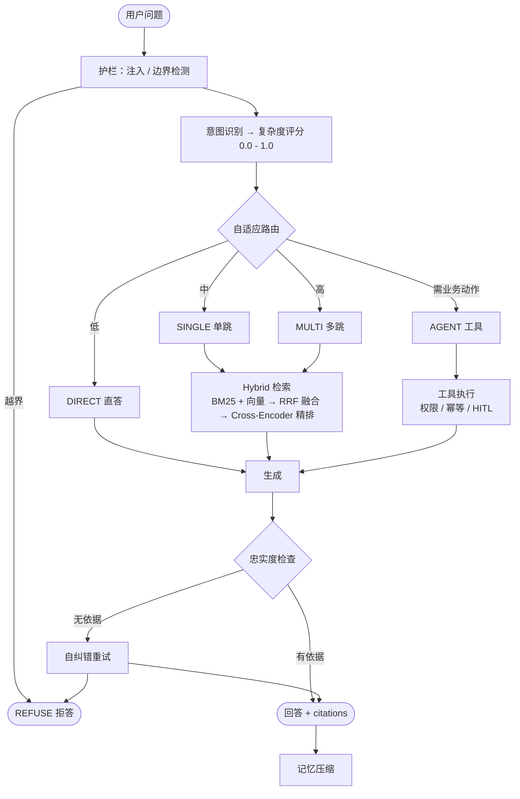

<picture>
  <source media="(prefers-color-scheme: dark)" srcset="docs/assets/hero-dark.svg">
  <source media="(prefers-color-scheme: light)" srcset="docs/assets/hero-light.svg">
  
</picture>

<p align="center">
  
  
  
  
  
  
  
  
  
  
</p>

<p align="center">
  <a href="#快速开始">快速开始</a> ·
  <a href="#系统架构">系统架构</a> ·
  <a href="#实测结果">实测结果</a> ·
  <a href="docs/README.md">技术文档</a> ·
  <a href="docs/tutorial/README.md">教学文档</a> ·
  <a href="eval/MEASURED.md">实测原始数据</a>
</p>

---

## 一句话

> 按问题复杂度选择 `DIRECT / SINGLE / MULTI / AGENT / REFUSE`，而不是对所有 query 做一次 `top_k` 向量检索。

## 这是什么

这是一个可以本机跑起来的 Adaptive-RAG 电商客服工作流。它回答退货政策、查询订单与物流、在用户授权后发起退款或取消，并且在证据不足或请求越界时明确拒答。整个项目围绕一个判断展开：**不同的问题不该走同一条链路**。问候语不需要检索，单条政策问题一次混合检索就够，而「定制马克杯过了七天但有质量问题能不能退」同时牵扯定制商品规则、时效条款和质量例外，需要拆成多个子问题、多跳检索并交叉验证。把这三类问题塞进同一个 `top_k=5` 的向量检索里，要么长尾政策命中不了，要么把上下文塞满噪声。

因此这个仓库的重点不在「用了 RAG」，而在**把 RAG 做成一件可控的工程**。检索策略是一个枚举而不是散落的 `if`，路由可以单独测试；每一次外部调用都有超时和退避，并且区分「业务失败」与「系统失败」；写操作默认不执行，必须先返回 `pending_action` 等待人工确认；会话上下文有明确预算，超阈值时分级压缩；所有对外承诺的数字都来自仓库里的离线评测脚本，而不是手写的估算。

需要强调的是，这个仓库里的每一条能力声明都能在代码里找到对应实现。README 与技术文档只写仓库真实存在的行为，没做的部分集中列在[限制](docs/12-limitations.md)里，不靠模糊措辞掩盖。

## 为什么不是「一次向量检索」

常规的单跳 RAG 有一个隐含假设：问题的答案就在某一段文本里，检索到它就能回答。电商客服场景会同时打破这个假设的两端。

一端是**过度检索**。「你好」「谢谢」这类输入被送进向量库，召回一堆无关政策，既浪费 token 又给幻觉留了空间。另一端是**检索不足**。用户的真实诉求常常是复合的：商品属性、时间约束、政策条款、订单状态分散在四个地方，单次检索的 `top_k` 无论调多大都难以同时覆盖，而多跳检索又需要先知道该拆成哪几跳。

这个仓库的解法是把「要不要检索、检索几跳、要不要调工具」这三件事从提示词里抽出来，变成一个可枚举、可测试、可观测的决策。决策结果既写在 SSE 事件里（客户端能看到 `strategy`），也打在 Prometheus 指标上（能按策略看延迟和错误率）。

| 常见做法 | 典型失败模式 | 本仓库的处理 |
|---|---|---|
| FAQ 关键词客服 | 长尾政策命中差 | BM25 与向量并行召回，RRF 融合 |
| 常规单跳 RAG | 多约束问题推不动 | 路由到 Self-RAG 多跳，改写后多路检索 |
| 无护栏生成 | 幻觉、越权退款、提示注入 | 忠实度检查、HITL 确认、注入与边界检测 |
| 长会话 Agent | Token 无限膨胀 | 128k 预算，50% / 70% / 85% 三级压缩 |

## 五条检索策略

策略定义在 `app/core/enums.py` 的 `RetrievalStrategy`，LangGraph 的条件边按它分流：

| 策略 | 触发条件 | 行为 |
|---|---|---|
| `DIRECT` | 问候、闲聊等无需知识 | 不检索，直接生成 |
| `SINGLE` | 单跳政策问题 | 一次 Hybrid 检索，融合后精排 |
| `MULTI` | 多约束、需交叉验证 | 查询改写 + 多路检索 + Self-RAG 自纠错 |
| `AGENT` | 需要业务动作或实时数据 | Planner 规划 → 工具执行（带权限与幂等） |
| `REFUSE` | 越权、注入、证据不足 | 明确拒答或转人工 |

把它收敛成枚举的直接收益是：路由逻辑可以脱离 LLM 单独做单元测试，策略可以透出到 API 响应，指标可以按策略分桶。如果这段逻辑写成一个大 `if query:` 分支，失败路径既测不了也讲不清。

## 系统架构

请求从 HTTP 进入后，依次经过护栏、意图识别、复杂度评分与自适应路由，再由检索或工具链路产出答案：



记住这一条路径，就能自己画出整张架构图：

```text
HTTP → ChatService → LangGraph → Retriever 或 Tool → Provider / DB
```

Graph 一共 10 个节点（`app/agents/graph.py`）：`apply_guardrail`、`classify_intent`、`route_complexity`、`retrieve_docs`、`plan_tasks`、`execute_tools`、`generate_answer`、`refuse_answer`、`check_faithfulness`、`compact_memory`。完整的分层说明、启动降级链路与检索降级链路见[架构图与运行流程](docs/17-architecture-flow.md)。

## 快速开始

默认使用 **SQLite + 内存向量库**，不强制 Docker，目标是 5 分钟内让 `POST /api/v1/chat` 跑通。

```bash
python3.12 -m venv .venv
source .venv/bin/activate
pip install -e ".[dev]"

# 可选：本地 bge-small 召回 + Cross-Encoder 精排
pip install -e ".[rerank]"
# 可选：Unstructured 解析 PDF / Office / HTML / 图片
pip install -e ".[docs]"

cp .env.example .env
python -m scripts.seed_demo  # 可选：初始化下方演示订单
uvicorn app.asgi:app --reload --port 8000
```

`.env` 的最小集只需要三行，其中 `DEEPSEEK_API_KEY` 可留空——留空时会自动切到 `FakeLLMProvider`，链路照常跑通，只是回答变成占位内容。

```bash
APP_ENV=development
DATABASE_URL=sqlite+aiosqlite:///./data/local/app.db
DEEPSEEK_API_KEY=sk-...   # 可选，回答质量依赖它
```

服务起来之后，探活并发第一个问题：

```bash
curl -s localhost:8000/api/v1/health
curl -s localhost:8000/api/v1/chat \
  -H 'content-type: application/json' \
  -d '{"message":"定制马克杯过了7天但是有质量问题能退吗","user_id":"u_demo"}'
```

返回里会有 `trace_id`、`strategy`（这一问通常是 `multi` 或 `single`）以及带 `citations` 的回答。也可以在同一个终端连续对话，CLI 会直接连上已启动的 API，不重复加载模型：

```bash
python -m app.cli
```

运行 `python -m scripts.seed_demo` 后会创建三个属于 `u_demo` 的演示订单，用于体验工具调用与人工确认流程；服务启动本身不会自动写入演示数据：

| 订单号 | 状态 | 商品 |
|---|---|---|
| `ORD10001` | 已发货 | 降噪耳机 |
| `ORD10002` | 已签收 | 定制马克杯 |
| `ORD10003` | 已支付未发货 | T 恤 |

尝试取消 `ORD10003` 时不会直接写库，而是返回 `pending_action` 与一个 `confirm_action_id`，把该 id 填回请求后才会真正执行。这就是 HITL（Human-in-the-Loop）人工确认机制，完整流程见[智能体与工具](docs/05-agents-and-tools.md)。

```bash
pytest -q
python -m eval.runner --task retrieval
```

完整步骤、Docker 部署与依赖降级说明见[快速开始](docs/02-getting-started.md)和[部署](docs/11-deployment.md)。

## 实测结果

以下数字来自 2026-08-22 的一次完整离线评测：`HF_HUB_OFFLINE=1 python -m eval.runner --task all --llm`，生成模型为 DeepSeek `deepseek-chat`，稠密召回为 `BAAI/bge-small-zh-v1.5`（512 维），精排为本地 Cross-Encoder `BAAI/bge-reranker-base`。逐项口径见 [`eval/MEASURED.md`](eval/MEASURED.md) 和[完整测评报告](docs/14-evaluation-report.md)；该轮原始 JSON 未随仓库分发（`eval/reports/*.json` 已在 `.gitignore` 中忽略）。

| 环节 | 规模 | 指标 |
|---|---|---|
| 意图识别 | 100 条 | 关键词规则 51% → `intent_v3` 加覆盖层 **100%** |
| 稀疏检索 BM25 | 65 条 / 39 篇 | P@1 **76.9%** · R@3 **90.0%** · MRR **0.84** |
| 仅稠密 bge-small | 65 条 / 39 篇 | P@1 **83.1%** · R@3 **94.6%** · MRR **0.89** |
| Hybrid + Cross-Encoder | 65 条 / 39 篇 | P@1 **89.2%** · R@3 **97.7%** · MRR **0.94** |
| 生成忠实度 | 65 条 | 无检索 80% → RAG 96.9% → RAG + 自纠错 **100%** |
| 生成幻觉率 | 65 条 | 无检索 20% → RAG 3.1% → RAG + 自纠错 **0%** |
| 端到端 | 16 条 | 拒答 100% · 工具路径 100% · 关键词 9/11 · P50 4.9s / P95 5.8s |
| 回归测试 | 155 项 | `pytest -q` **155 passed**，覆盖率 **73%**（2026-10-12 复测） |

有五个口径容易被误读，这里主动说明。意图的 100% 含一层规则覆盖，不是纯 LLM 分类器的成绩；本集上 RRF 与仅用 bge-small 的数字相同，**增益实际来自 Cross-Encoder 而非融合**，所以不宣称 RRF 必然优于单路；端到端关键词命中是 9/11 而不是 100%；幻觉评测使用同模型裁判，结论偏乐观；回归测试一行是 2026-10-12 单独复测的，与上面 2026-08-22 的评测指标不是同一次运行。

## 文档

仓库里有两套文档，面向不同场景。

**技术文档**（[docs/README.md](docs/README.md)）是生产向手册，结构参考 Diátaxis：先能跑，再讲概念，再查参考，最后看上线。每章的重点机制固定三块——**要点 → 代码摘要（带真实文件路径）→ 为什么**，避免只讲概念不给代码。

| 想了解 | 去看 | 对应代码 |
|---|---|---|
| 5 分钟跑通 | [02 · 快速开始](docs/02-getting-started.md) | `app/asgi.py`、`app/services/seed.py` |
| 分层与 Graph | [03 · 架构](docs/03-architecture.md) | `app/agents/graph.py` |
| Adaptive-RAG / RRF / Self-RAG | [04 · 检索](docs/04-adaptive-rag.md) | `app/retrieval/` |
| 解析 / 切块 / 向量库 / 精排 | [15 · 解析与检索](docs/15-ingest-and-retrieval.md) | `app/retrieval/`、`app/providers/embeddings.py` |
| 意图 / Skill / 工具 / HITL / MCP | [05 · 智能体与工具](docs/05-agents-and-tools.md) | `app/agents/nodes/`、`app/tools/`、`app/mcp/` |
| HTTP 与 SSE | [06 · API 参考](docs/06-api-reference.md) | `app/api/routes/chat.py` |
| 超时重试与指标 | [08 · 可靠性](docs/08-reliability.md) | `app/core/retry.py`、`app/observability/` |
| 注入 / 越权 / 密钥 | [09 · 安全](docs/09-security.md) | `app/guardrails/`、`app/tools/permissions.py` |
| 评测与口径 | [10 · 评测](docs/10-evaluation.md)、[14 · 测评报告](docs/14-evaluation-report.md) | `eval/runner.py`、`eval/MEASURED.md` |
| 项目面试书 | [Chapter 1](docs/interview/chapter1.md) · [Chapter 2](docs/interview/chapter2.md) · [Chapter 3](docs/interview/chapter3.md) · [17 维度索引](docs/16-interview-bagu-map.md) | 场景 → 机制 → 源码 → 边界 |

**教学文档**（[docs/tutorial/README.md](docs/tutorial/README.md)）是另一套面向学习的材料，共 **12 个部分、43 篇正文**，另附术语表、环境变量、练习答案、源码阅读顺序与完整测评数据表。全书按「打基础 → 提质量 → 管上下文 → 做决策 → 控风险 → 拿证据与上生产」六个阶段组织，从向量与相似度讲起，逐层推进到索引构建、召回、融合精排、查询改写、上下文压缩、意图路由、工作流与工具、安全护栏，最后用评测体系与工程化上线收尾。每篇正文的关键技术实现处都附有仓库里的真实源码片段，末尾还有一句指标回指，指向评测体系中的对应数字。行文风格参考了 Datawhale 的 [all-in-rag](https://github.com/datawhalechina/all-in-rag) 教程。

## 项目结构

```text
app/
  api/            HTTP：路由、校验、SSE
  services/       ChatService、DI 容器、种子数据
  agents/         LangGraph 状态机与 10 个节点
  retrieval/      解析、清洗、切块、BM25、向量、RRF、Adaptive、Self-RAG
  tools/          15 个业务工具 + Registry + 权限校验
  mcp/            本地 / 远程 MCP，统一成 Tool 接口
  skills/         退货、跟踪、推荐 JSON，按需加载
  repositories/   订单、会话、幂等
  providers/      DeepSeek / Embedding / Cross-Encoder
  guardrails/     注入检测、边界判定、忠实度
  memory/         128k 预算与三级压缩
  prompts/        版本化模板
  observability/  JSON 日志、Prometheus、contextvars
knowledge/        政策文档（Markdown；生产环境还可 PDF / Office / HTML / 图片）
eval/             离线评测集与 runner
tests/            unit / integration / e2e 三层
docs/             技术文档 + 教学文档
```

## 工程质量

**分层与依赖注入。** HTTP 层只负责校验与序列化，业务编排在 `ChatService`，检索与工具通过容器组装，便于替换实现和在测试里注入假对象。

**失败被分成两类。** 业务失败（证据不足、越权）是 200 加文案，系统失败才走错误码与 HTTP 状态。外部调用统一超时，`408 / 429 / 5xx` 可重试且带全抖动退避，`401 / 403` 不重试。

**写操作默认不落地。** 工具调用带权限判定、风险分级与幂等键。高风险写操作先返回 `pending_action`，用户确认后才执行，重复确认不会重复扣减。

**关键路径可单测。** RRF 融合、复杂度路由、上下文压缩、工具权限、Skill 匹配、MCP 代理、执行降级与自纠错都有单元测试，`tests/conftest.py` 会清空真实 API Key 并 mock 模型权重，测试不打真实接口也不下载模型。

**CI 守门。** `.github/workflows/ci.yml` 在每次 push 和 PR 时于 Python 3.11 与 3.12 上依次跑 `ruff format --check`、`ruff check` 与 `pytest`，三项任一失败即标红，避免文档里的「代码干净、测试全过」变成口头承诺。

**可观测。** 请求带 `trace_id` 贯穿全链路，日志为结构化 JSON，指标覆盖延迟、token、路由分布与错误率，并可按策略维度下钻。

## 已知限制

这个项目是工程能力的展示，不是已上线的生产系统，以下几点在[限制与路线图](docs/12-limitations.md)里有逐条对照。

订单与物流使用仓储种子数据，没有接真实承运商或支付网关。知识库在启动时全量 ingest，还没有增量删除接口。Token 预算使用启发式估算而非官方 tokenizer。多租户仅靠 `user_id` 字符串隔离。Embedding 与精排默认走本地小模型，权重不可用时会降级到词面策略，降级后的效果未单独评测。

## 参与贡献

依赖只以 `pyproject.toml` 为准，代码用 Ruff 格式化与检查，业务逻辑分层存放、通过 schema 传递数据。提交前请跑通 `ruff format . && ruff check . && pytest -q`，并确认没有带上 `.env`、密钥或评测生成物。详见[贡献指南](CONTRIBUTING.md)。

## 许可

本项目以 [MIT 许可证](LICENSE) 发布，版权归 JEen-wang 所有。你可以自由使用、修改、分发，甚至用于商业项目，只需在副本或衍生作品中保留原始的版权声明与许可声明。软件按「原样」提供，不附带任何形式的担保。

---

<p align="center">
  <sub>所有对外数字的唯一权威来源是 <a href="eval/MEASURED.md"><code>eval/MEASURED.md</code></a>，测量日期 2026-08-22。</sub>
</p>
